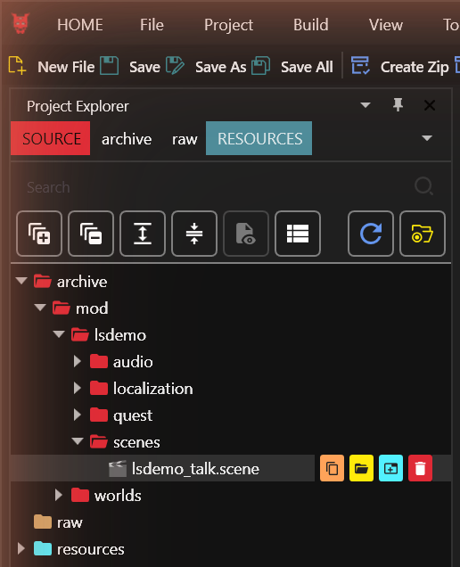
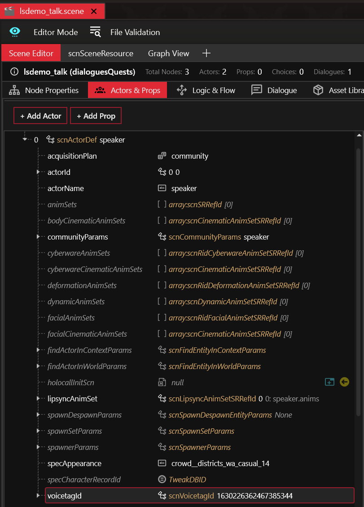
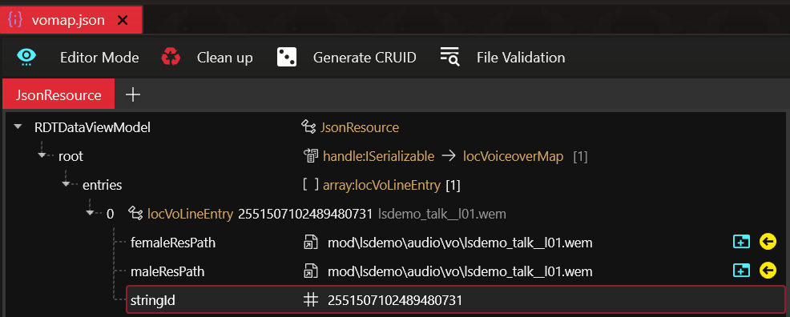
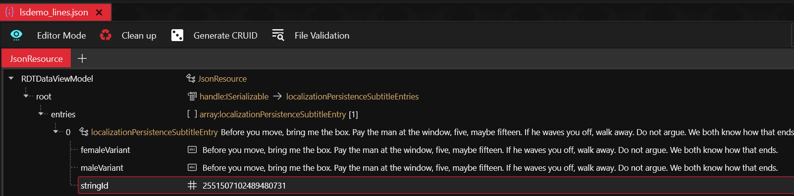
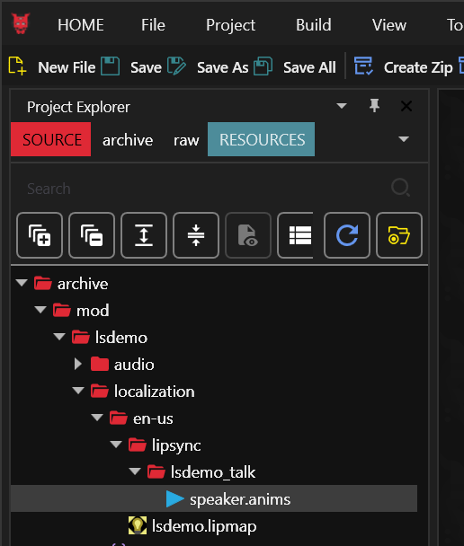
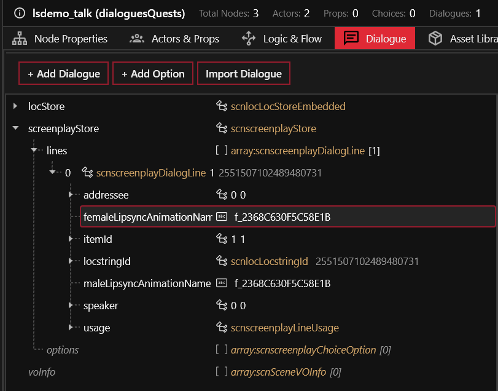
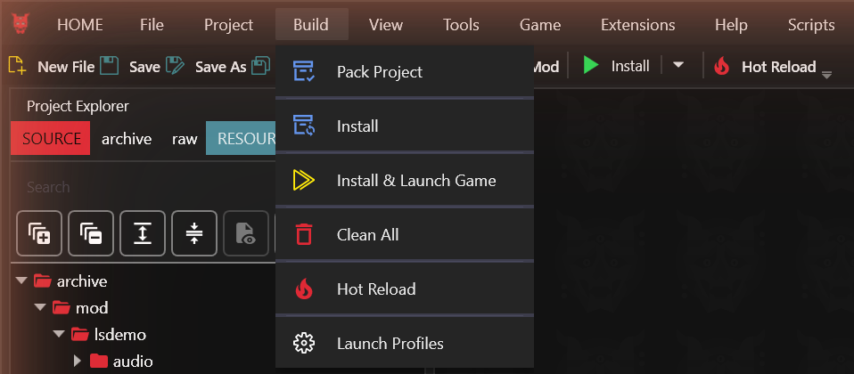
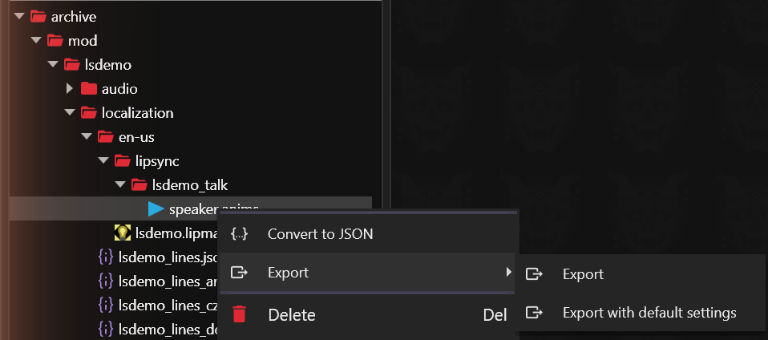

# Usage

In the pictures, the project is `lsdemo`, with one character, `speaker`,
and one line.

## A whole scene in WolvenKit

Before you start, back up your project or commit it to git. The tool also
saves a copy of each file it changes, see step 6.

1. Make the scene, with its characters and lines. Note its path in the
   Project Explorer, here `mod\lsdemo\scenes\lsdemo_talk.scene`.

   

2. Give each speaking character a voice tag: `voicetagId`, the last field
   of the actor on the Actors & Props tab. The game uses it to find the
   character's lipsync animations. Any number works, as long as each
   speaking character in the scene has a different one. WolvenKit leaves it
   at 0, and the tool skips any character left at 0. The picture shows a
   voice tag from the base game. An invented one, such as
   4242424242424242424, works too.

   

3. Add each line's audio file to the project and to a voice-over map, under
   the line's ID (`locstringId` in the scene).

   

4. Add each line's words to a subtitle file, under the same ID.

   

   The tool reads English files only. It skips any subtitle file or
   voice-over map with another language, such as `de-de`, in its folder or
   file name.

5. Close the scene's tab, or WolvenKit will save over the tool's changes.

6. Run the tool with your project folder (the one with the `.cpmodproj`
   file) and the scene's path. The path can start at `mod\` or at
   `archive\`, or be the file's full path:

       python -m lipsync_animator scene "C:\Mods\MyMod" mod\mymod\scenes\talk.scene

   A run takes about half a minute, for one line or for ten. Most of that
   time, the aligner and WolvenKit are starting up. While
   the aligner works, the tool prints only "aligning". Without the
   aligner, a run takes a few seconds.

   First it copies the files it is about to change into
   `lipsync_backup\<date and time>` in your project. To undo a run, copy
   them back.

   Then it makes one `.anims` file for each character, named after the
   character, in `mod\<project>\localization\en-us\lipsync\<scene>`, and
   links each line of the scene to its animation. `<project>` is the name
   of your `.cpmodproj` file. It also adds the scene to your lipmap, the
   file the game reads to find lipsync animations. If the project has none,
   it makes `mod\<project>\localization\en-us\<project>.lipmap`. The game
   loads the lipmap through ArchiveXL, so the tool adds it to
   `resources\<project>_lipsync.archive.xl`, unless one of your `.xl` files
   already has it. Players of your mod need ArchiveXL installed.

   If a run stops with an error part way, it says which backup folder to
   copy back.

   

7. Reopen the scene. Each line now names its own animation, `f_` and the
   line's ID in hexadecimal.

   

8. Pack and install as usual.

   

Run the tool again whenever a line's audio or words change. The tool skips
lines V speaks. Lines whose audio is not in your project, such as
vanilla lines, keep the lipsync animation they already use.

## Single lines

To replace some animations in one existing lipsync set yourself, without
the `scene` command:

1. In WolvenKit, add the set to a project, right-click it and choose
   Export. The `.anims.glb` appears in the project's `raw` folder. Here the
   set is `START.anims`.

   

2. List your lines in `lines.json`. `name` is the animation's name, as the
   scene's line gives it in `femaleLipsyncAnimationName` and
   `maleLipsyncAnimationName`:

       [
         {"name": "f_00000000CAFE0001", "audio": "line1.wav",
          "text": "What the line says, word for word."}
       ]

   The audio can be `.wav`, `.ogg`, `.flac` or `.wem`.

3. Make the animations, then write the `.anims`:

       python -m lipsync_animator make --set START.anims.glb --lines lines.json --out OUT.anims.glb
       python -m lipsync_animator import --glb OUT.anims.glb --anims START.anims --out OUT.anims

   If the set already has an animation with that name, the tool replaces
   it. Otherwise it adds a new one.
   For one line, use `--name`, `--audio` and `--text` instead of `--lines`.

4. Put `OUT.anims` in your project at the path of `START.anims`, under the
   same name, and pack. The game plays a new animation when a scene line
   names it. For that, the scene must list the set, and your lipmap must
   give the set to the character. You set up both in WolvenKit yourself.

   If `START.anims` is a vanilla set, your packed copy replaces it in every
   scene of the game that uses it.

## Builds outside WolvenKit

If you make your mod with a script instead of WolvenKit, use `anims`. It
writes only the `.anims` files. Your script then links the scene, its
lines and the lipmap to them, as `scene` does in WolvenKit.

    python -m lipsync_animator anims --lines lines.json --out speaker.anims

`lines.json` is the same list as in "Single lines". For several sets in
one run (much faster than one run per set), give `--sets` a JSON list
instead:

    [
      {"out": "C:/MyMod/lipsync/talk/speaker.anims",
       "lines": [{"name": "f_00000000CAFE0001", "audio": "C:/MyMod/vo/line1.wem",
                  "text": "What the line says, word for word."}],
       "copy": [{"from": "base\\localization\\en-us\\lipsync\\base\\quest\\main_quests\\prologue\\q005\\afterlife\\scenes\\00_afterlife_global_scene\\civ_mid_m_21_enus_25.anims",
                 "names": ["f_1F5FC0BC394E2000"]}]}
    ]

`copy` copies animations unchanged from another set: an `.anims` file, or
a set in the game's voice archives. Use it only when a character speaks
both new lines and the game's own lines in one scene, because the game
gives each character one set per scene. A character who speaks only the
game's lines can use the game's own set. `python -m
lipsync_animator anims --help` gives every option.

## Tips for your audio files

- Leave about 0.3 s of silence before the first word and after the last.
  If the voice starts straight away, the tool fades in the first tenth of
  a second of the animation.
- Write the words exactly as spoken, names included. Write numbers as
  words ("fifteen", not "15"). Without the aligner, the tool skips digits.

## If something is not found

- WolvenKit elsewhere than `%LOCALAPPDATA%\Programs\WolvenKit`: add
  `--wolvenkit <its folder>`.
- The game elsewhere than Steam's default folder: add `--game <its folder>`.
- The aligner installed elsewhere: put the command that runs it in the
  `LIPSYNC_MFA` environment variable.
- `--no-aligner` skips the aligner even when it is installed.
